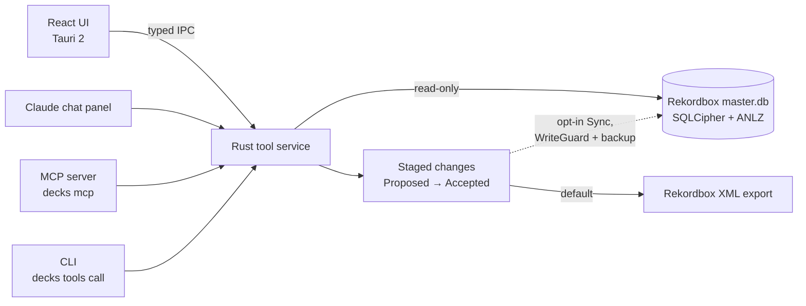

<h1 align="center">decks</h1>

<h3 align="center">An AI assistant that cleans up a DJ's music library — and can't change anything you haven't approved</h3>

<p align="center">
  DJs keep thousands of tracks in Rekordbox, but fixing messy titles, missing cue points,<br>
  duplicates, and broken file paths happens one track at a time. decks audits the whole library,<br>
  lets a Claude agent propose fixes in bulk, and stages every change for review before it's written.
</p>

<p align="center">
  <a href="#-run-it-locally">🚀 Run locally</a> ·
  <a href="docs/ROADMAP.md">🗺 Roadmap</a> ·
  <a href="docs/lexicon/PARITY.md">📊 Feature-parity matrix</a>
</p>

<p align="center">
  <a href="https://github.com/cole-hackman/decks/actions/workflows/ci.yml"></a>
  <a href="LICENSE"></a>
  
  
</p>

<p align="center">
  <sub>
    🦀 Rust core, ~20 crates ·
    🖥️ Tauri 2 desktop app ·
    🔌 Same tools exposed as an MCP server and a CLI ·
    📡 No telemetry
  </sub>
</p>

<!-- HERO: the differentiator shot — the chat panel proposing changes with the
staged-changes diff view open next to the track table (Proposed → Accepted
lifecycle visible). Second choice: track detail with the native ANLZ color
waveform. Use a fixture library, not a real one.
Save as docs/media/hero.png (keep under 5MB) and replace this comment with:
<p align="center"></p>
-->

> [!NOTE]
> **Status: MVP in progress.** Core desktop workflows and the local MCP tooling
> work; real-library validation and a first tagged release (v0.1.0) remain.

---

### Menu

- [Features](#-features)
- [The problem](#-the-problem)
- [How it works](#-how-it-works)
- [Run it locally](#-run-it-locally)
- [Scope and non-goals](#-scope-and-non-goals)
- [Tradeoffs](#-tradeoffs)
- [Known limitations](#-known-limitations-and-failure-modes)
- [What I'd do next](#-what-id-do-next)
- [Stack](#-stack)

---

## ✨ Features

- **Library audits** — tracks with no cues, tracks in no playlist, inconsistent artist and title formatting
- **Audio duplicate detection** and **broken-path relocation**
- **Smart Fixes and Cleanup** that propose changes across thousands of tracks at once
- **A Claude agent in the app** that can see only what you've shown it and can only act through reviewable changes
- **Every edit is staged** — `Proposed → Accepted/Rejected → Exported/Applied`, previewable as a diff
- **Safe write-back** through Rekordbox XML export, or an opt-in direct sync with an automatic backup
- **One tool service, three surfaces** — the in-app chat, an MCP server for any MCP host, and a CLI
- **Everything on your machine** — no telemetry; the Anthropic key lives in the OS keychain

---

## 🧩 The problem

Rekordbox is built for performing, not for library hygiene. Normalizing
artist and title formatting across thousands of tracks, finding tracks with
no cues or no playlist, spotting audio duplicates, and relocating broken
file paths are all one-track-at-a-time chores in its UI. The paid benchmark
for this job is Lexicon DJ; decks is working toward Lexicon parity within
Rekordbox (the parity matrix in [`docs/lexicon/PARITY.md`](docs/lexicon/PARITY.md)
drives the roadmap) as a local-first desktop app with an agent attached — one
that can see only what you've shown it and can only write through staged,
reversible changes.

<!-- TODO: verify — one line on provenance (built against your own library?
what chore triggered it?). See README-QUESTIONS.md. -->

---

## 🔧 How it works



- **A Tauri 2 desktop app:** React/TypeScript frontend over a Rust workspace
  (~20 crates, one per bounded concern), with typed IPC between them.
- **Reads Rekordbox directly.** `crates/rekordbox-db` opens Rekordbox 7's
  SQLCipher `master.db`, read-only, and parses the native ANLZ files (beat
  grids, color waveforms). Audio features, waveform peaks, fingerprints, and
  chat history live in a local SQLite (WAL) cache.
- **Every mutation is a staged change** — from the agent, Smart Fixes,
  Cleanup, or the Duplicates view: `Proposed → Accepted/Rejected →
  Exported/Applied`, previewable as a diff. The default egress is
  round-trip-tested Rekordbox XML export; an opt-in Sync flow writes directly
  to `master.db` under a `WriteGuard`.
- **One tool service, three surfaces:** the in-app Claude chat panel, an MCP
  server (`decks mcp` / `decks mcp-http`) usable from any MCP host on your
  existing subscription, and a `decks tools call` CLI.
- **Everything runs on your machine.** No telemetry; enrichment APIs
  (MusicBrainz, opt-in Discogs) only fire if enabled, through a local cache.

---

## 🚀 Run it locally

Requirements:

- [Rust stable](https://www.rust-lang.org/tools/install)
- [Node 20+](https://nodejs.org/) and [pnpm 9+](https://pnpm.io/)
- A Rekordbox 7 library (`master.db`) to point at

```bash
git clone https://github.com/cole-hackman/decks
cd decks
./scripts/dev.sh
```

**Tests** run against synthetic fixture libraries in `fixtures/` — no real
library needed:

```bash
cargo test --workspace
pnpm test && pnpm typecheck && pnpm lint
pnpm e2e                            # Playwright
./scripts/real-library-smoke.sh     # data-layer smoke vs a real master.db copy
```

---

## 🎯 Scope and non-goals

**In scope:** Rekordbox 7, deep — browsing, auditing, smart fixes,
duplicates, relocation, cues, smartlists, staged edits back to the
library.

**Not in scope (deliberately, for now):**

- Other DJ software (Serato, Traktor, Engine DJ, VirtualDJ) and USB/CDJ
  export — deferred until Rekordbox parity is done.
- Cloud anything: no sync, no backup service, no mobile app.
- Silent fixes. Playlist duplicate entries are surfaced, not auto-removed;
  every change is staged for review.

---

## 🔀 Tradeoffs

**Staged changes everywhere, direct writes almost nowhere.** The founding
invariant was "never mutate `master.db`" — all edits stage into a
reviewable batch and leave via XML export the user imports manually. That
bought trust (an agent can propose bulk edits to a library you care about
with zero blast radius) and cost friction: for "rename one genre across
200 tracks," quit-Rekordbox-and-import is a heavy loop. ADR-0010 formally
relaxed the invariant for one path: an opt-in Sync that writes in-place,
gated by a `WriteGuard` that probes Rekordbox's WAL lock, takes a
timestamped backup on first write, and commits atomically — reducing the
worst case from "library destroyed" to "copy the `.bak` back."

**Tauri 2 over Electron.** The core logic is Rust (SQLCipher access, audio
analysis, DSP), so Tauri lets the frontend call it directly instead of
through an FFI or subprocess boundary, and ships a ~5–10 MB binary using
30–80 MB of memory — which matters when Rekordbox and a DAW are open next
to it. The cost: the system WebView differs per OS (Safari, WebView2,
WebKitGTK), so rendering must be verified on each platform instead of once
in a bundled Chromium.

---

## 🚧 Known limitations and failure modes

- It has not been validated against a real library at scale yet — that's
  the line between here and v0.1.0. Synthetic fixtures cover the test
  suites; real Rekordbox databases have column variants and ANLZ quirks
  the fixtures don't.
- The whole foundation is a reverse-engineered format: SQLCipher schema
  and ANLZ binary parsing (vendored and adapted from MIT-licensed
  reklawdbox). A Rekordbox update can break reads — and the Sync write
  path — overnight.
- An agent session once shipped a non-compiling workspace while its notes
  claimed "verified clean." ADR-0009 is the scar: agent-built work is
  untrusted until the full verification suite passes, and "done" claims
  without captured command output don't count.
- CI runs the Rust suite (fmt, clippy, tests) on macOS and Windows plus
  frontend typecheck/lint/vitest — but the Playwright e2e suite and the
  real-library smoke are local-only gates, and Linux isn't in the matrix.
- No telemetry cuts both ways: nothing phones home, and nothing tells me
  what broke on someone else's machine.

---

## 🧭 What I'd do next

1. **Real-library validation and the v0.1.0 release** — the smoke harness
   exists; it needs to be run in anger against large libraries.
2. **Work down the Lexicon parity matrix** ([`docs/lexicon/PARITY.md`](docs/lexicon/PARITY.md))
   — one epic per branch, already queued in [`docs/ROADMAP.md`](docs/ROADMAP.md).
3. **Put Linux in the CI matrix and get e2e running in CI,** so the
   three-WebView cost of the Tauri decision is actually paid down.

---

## 🧱 Stack

| Layer | Technology |
|---|---|
| Desktop shell | Tauri 2 |
| Core | Rust (~20-crate workspace) · SQLite / SQLCipher |
| Frontend | React · TypeScript · Vite · Tailwind |
| AI | Claude (in-app chat) · MCP server |
| CI | GitHub Actions — Rust fmt, clippy and tests on macOS and Windows; frontend typecheck, lint and vitest |

## 📄 License

GPL-3.0-or-later — see [LICENSE](LICENSE) and [NOTICE](NOTICE).

decks is not affiliated with or endorsed by AlphaTheta / Pioneer DJ (Rekordbox)
or Lexicon DJ.

Built by [Cole Hackman](https://colehackman.com).
